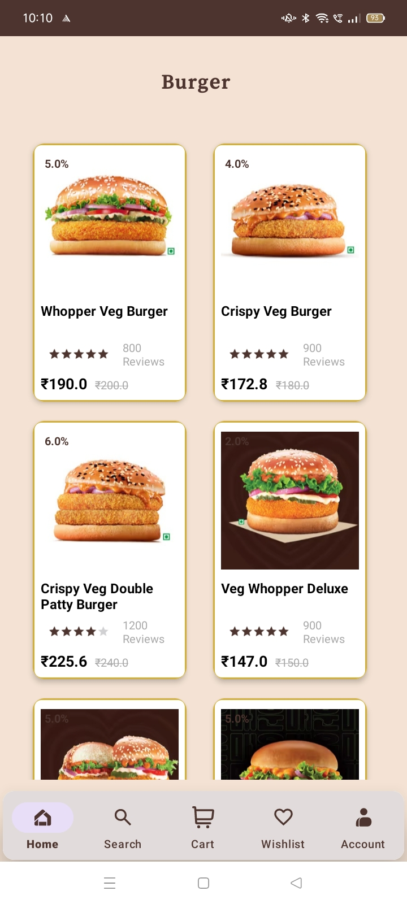
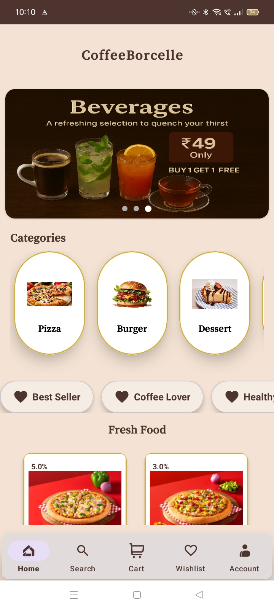
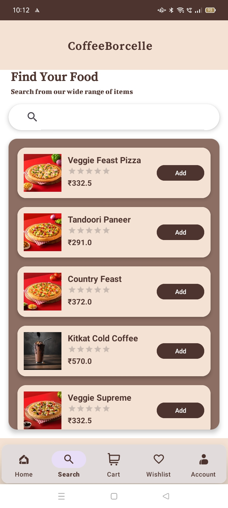
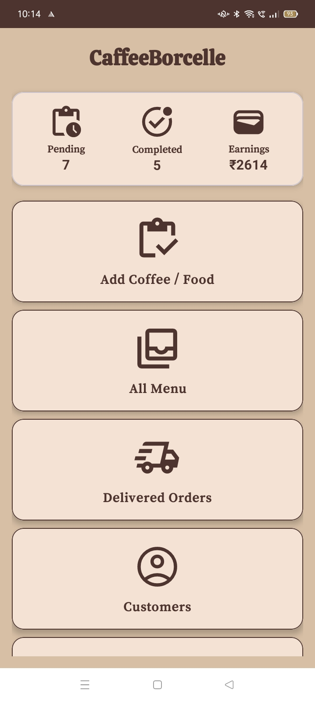
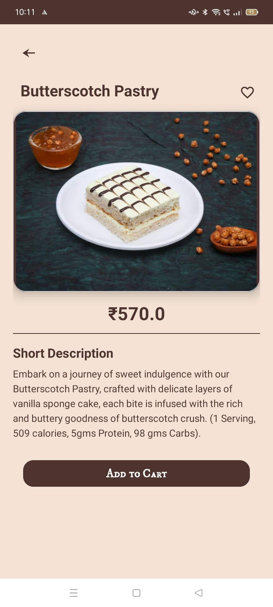
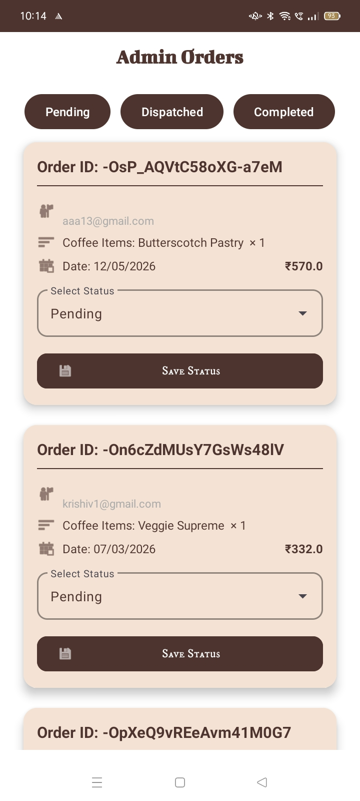
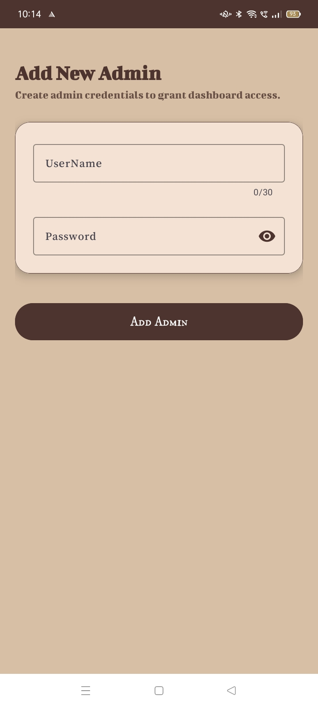
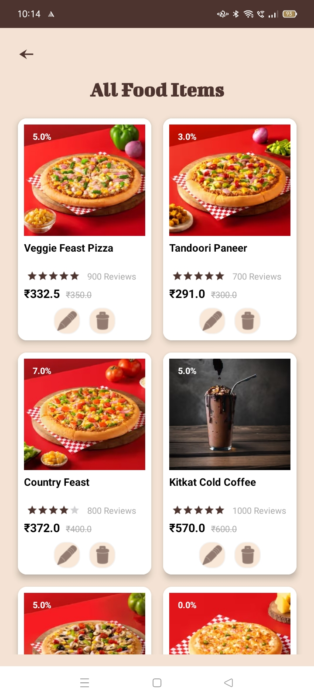

# ☕ Coffee Borcelle – Food Ordering Android App

Coffee Borcelle is an Android food ordering application developed using Kotlin and Firebase.

## 📱 About the Project

Coffee Borcelle allows users to browse food items and place orders through an Android application. It also includes admin-side functionality for managing products and orders.

## ✨ Features

- Food menu and item browsing
- Food ordering and checkout
- User registration and login
- Product and category management
- Admin dashboard and order management
- Firebase integration

## 🛠️ Tech Stack

- **Language:** Kotlin
- **IDE:** Android Studio
- **UI:** XML Layouts
- **Backend:** Firebase
- **Build System:** Gradle

## 📸 Screenshots

App screenshots will be added here.

## 🎯 Project Objective

This project was developed to practice Android application development and build practical skills in Kotlin, UI design, Firebase integration, and application workflows.

## 👩‍💻 Developer

Urvashi Sarvaiya

## 📸 App Screenshots

### Home Screen

### Login Screen

### Menu Screen

### Food Details

### Cart Screen

### Checkout Screen

### Order Screen

### Admin Screen

